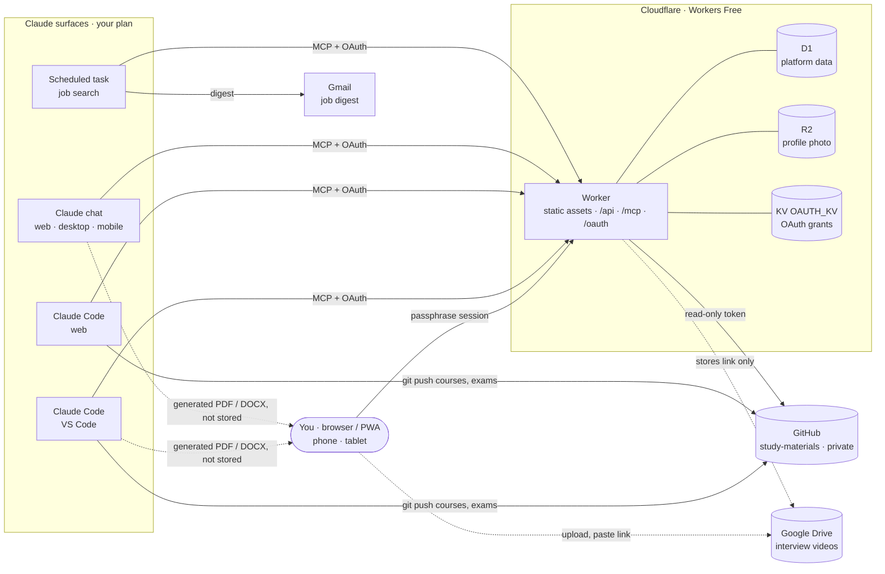

# Projects Lab — Architecture

_Status: platform architecture, agreed through questionnaires round 1 and 2 (2026-10-13). Updated 2026-10-17: career documents are generated on demand by Claude and never stored (R3-1, replaces R2-10). Lab-specific architecture is added when each lab's PRD is written._

This file records only the **deltas** from `PROJECT-STARTER-PLAYBOOK.md`. Everything the playbook decides (stack, auth, CI/CD, migrations, D1 rules, verification discipline) applies unchanged unless a row below says otherwise.

---

## 1. What Projects Lab is

One web app that hosts **labs**: modules that each run one kind of productive workflow, and share data with each other.

| Lab | Workflow | Status |
|---|---|---|
| **Study Lab** | Backlog of topics → course → final exam → grade. Everything cs-learning-lab does today. English, AI, CS and so on are **areas** inside it, not separate labs. | First lab |
| **Career Lab** | Profile, skills and gaps, per-role documents (resume, cover letter, self-introduction, salary range), form-filling help, automated job search, interview answers. Absorbs `job-mapper`. | Second lab |

**The one rule that shapes everything:** the app contains **no LLM** and no Anthropic API key. Every intelligent output (a course, a grade, a resume, a job match) is produced by a Claude session on your Claude plan and delivered to the app over MCP, or pushed to git.

---

## 2. System context



**Two write paths, never mixed.** Generated career documents take neither: they go straight to you.

| What | Written by | Stored in | The app's access |
|---|---|---|---|
| Course and exam **content** (Markdown, exam PDF, images) | Claude Code, by `git push` | `study-materials` repo | Read-only |
| Everything else: backlog, grades, profile, skills, jobs, openings | You (web UI → `/api`) or Claude (MCP → `/mcp`) | D1, plus R2 for your profile photo | Read-write |
| Resumes, cover letters, any other career file | Claude, on demand, from the profile | **Not stored**: returned to you (§6.4) | — |

---

## 3. Deltas from the playbook

| Concern | Playbook default | Projects Lab |
|---|---|---|
| Product shape | One app, one domain | One app hosting **lab modules** compiled in. See §4 |
| Credentials | Passphrase → session JWT | Two credential types: session JWT for `/api`, **OAuth 2.1 access token** for `/mcp`. See §6 |
| Bindings | D1, R2 | D1 `DB` · R2 `FILES` · **KV `OAUTH_KV`** (required by `workers-oauth-provider`) |
| Secrets | `TOKEN_SIGNING_KEY` | + **`GITHUB_TOKEN`**: fine-grained, Contents read-only, `study-materials` only. Fresh per project, never shared. (`UPLOAD_SIGNING_KEY`, for the signed uploads built in F-18, is removed by F-23: R3-1 left them without a use) |
| `run_worker_first` | `["/api/*"]` | `["/api/*", "/mcp", "/oauth/*", "/.well-known/*"]`. Still an array, never `true` |
| Content | Lives in D1/R2 | Study content lives in **git** (`study-materials`). D1 stores only paths and metadata. See §7 |
| Caching | Not specified | **Don't rely on the Workers Cache API**: on a `workers.dev` hostname it can't be counted on. Content is addressed by git blob SHA and cached **in the client** as immutable. See §7 |
| R2 | Images | One bucket, `projects-lab-images` (`projects-lab-images-preview` for preview), profile photo only; generated documents are never stored (§6.4). **Never video** |
| Video | — | Google Drive. You upload; the app stores the link and embeds Drive's player |
| Cron | Prune job | One Cron Trigger, daily prune. The job search is **not** a Worker cron; it's a Claude scheduled task (§8) |
| Email | — | None sent by the app. The job digest goes out from the scheduled task through your Gmail connector |
| Layouts | Phone | **Phone and tablet** designed. Desktop uses the tablet layout until daily use asks for more (assumption A-1) |
| Design | Claude Design handoff | Reuse sticker-collector's token structure, component set and token guard, with a **new, calmer theme** and a **per-lab accent**. See §9 |
| Numbers | Integers | Grades are **integer tenths**, 0–100 (a 8.5 is stored as 85) |

---

## 4. Labs as modules

```text
packages/
├── shared/src/
│   ├── core/            # constants, KDF, Zod schemas shared by every lab
│   ├── contracts/       # the ONLY way labs talk to each other (typed interfaces)
│   ├── study/           # Study Lab pure rules and schemas
│   └── career/          # Career Lab pure rules and schemas
├── api/src/
│   ├── core/            # auth, idempotency, helpers, skill registry, GitHub client
│   ├── mcp/             # MCP server: transport, tool registry, audit. No business logic
│   ├── labs/study/      # routes, services, MCP tools for Study Lab
│   ├── labs/career/     # routes, services, MCP tools for Career Lab
│   └── index.ts         # OAuthProvider wraps everything; mounts core + each lab
└── web/src/
    ├── core/            # shell, auth, lab switcher, home
    ├── components/ui/   # design system
    └── labs/{study,career}/
```

**Boundary rules (enforced in CI by Biome `noRestrictedImports`):**

1. `core` never imports from a lab.
2. A lab never imports from another lab. Cross-lab calls go through `shared/contracts/` interfaces, implemented by the owning lab and injected at mount time.
3. Every lab exposes the same three things: `routes` (Hono sub-app under `/api/<lab>`), `tools` (MCP tools prefixed `<lab>_`), and `screens` (React routes under `/<lab>`).
4. `@projects-lab/shared`'s root exports only `core` and `contracts`. Lab code in `shared/src/<lab>` is reached by subpath (`@projects-lab/shared/<lab>`, added with the folder), so a re-export can't carry one lab's code past the patterns above.

Enforced by `biome check .`; `scripts/check-boundaries.sh --self-test` (in `pnpm lint`) proves the rules still refuse each forbidden direction and allow contracts and the composition roots (`api/src/index.ts`, `web/src/app.tsx`). On the API, `core/lab.ts` `mountLabs` puts every lab behind `requireAuth` at `/api/<lab>` and refuses a tool not named `<lab>_[a-z_]+`.

The first contract, owned by Study Lab and consumed by Career Lab:

```ts
// packages/shared/src/contracts/study.ts
export interface StudyContract {
  /** Adds topics the backlog lacks; returns the topic ID for every skill, new or existing. */
  ensureTopics(input: { skillId: string; priority: 1 | 2 | 3; note: string }[]): Promise<{ skillId: string; topicId: string; created: boolean }[]>;
  /** Verified = a Done topic with grade ≥ 70 (tenths). */
  skillStatus(skillIds: string[]): Promise<{ skillId: string; verified: boolean; grade: number | null }[]>;
}
```

**Deferred on purpose:** a generic "lab plugin" abstraction. Revisit when a third lab exists and the real common shape is known.

---

## 5. Core data model (platform phase)

Playbook base tables, plus two platform tables. Lab tables (`learn_*`, `career_*`) are designed in each lab's PRD.

| Table | Columns | Purpose |
|---|---|---|
| `user` | playbook §7 | Single owner |
| `mutation` | playbook §7 | Idempotency, for `/api` and MCP write tools |
| `auth_attempt` | playbook §7 | Login rate limit, shared by the app login and the OAuth sign-in page |
| `skill` | `id`, `name` `COLLATE NOCASE UNIQUE`, `aliases_json`, `created_at`, `deleted_at` | **The shared entity.** One row per learnable skill with its canonical name ("PostgreSQL") and aliases ("Postgres"). Study topics, declared profile skills and job requirements all reference it, so cross-lab readiness is one `JOIN`, and deduplication (today done by `job-mapper` in prose) becomes a lookup |
| `mcp_call` | `id`, `tool`, `client_name`, `ok`, `created_at` | Audit of every MCP **write**, so you can see what Claude changed. Pruned after 90 days |

**Readiness**, decided in R2-15 and computed at read time, never stored:

| Status | Rule |
|---|---|
| **Verified** | A Study topic for the skill is Done with grade ≥ 70 |
| **Declared** | The skill is in your Career profile |
| **Gap** | Neither |

**Core invariants** (triggers or CHECKs in the custom migration, verified by `verify-triggers.sh`):
- `skill.name` is unique ignoring case, and never empty.
- A `skill` referenced by any lab row can't be hard-deleted.
- `mcp_call.tool` matches `^(core|study|career)_[a-z_]+$`.

---

## 6. Integration: MCP + OAuth

### 6.1 Why MCP (R2-6)

One remote MCP server on the same Worker lets **every** Claude surface read your profile and backlog and save results. Claude Code connects to it like any remote MCP server; claude.ai connects to it as a custom connector. Custom connectors support OAuth, are added on claude.ai, and are then usable from the iOS and Android apps ([Claude Help Center](https://support.claude.com/en/articles/11503834)).

### 6.2 Shape

- **Endpoint:** `/mcp`, Streamable HTTP, built with the Agents SDK's stateless `createMcpHandler`: no Durable Objects.
- **Auth:** `workers-oauth-provider` wraps the Worker's default export. It needs a KV namespace bound as `OAUTH_KV`, and stores tokens, codes and client secrets only as hashes ([library README](https://github.com/cloudflare/workers-oauth-provider)). Refresh tokens rotate.
- **Sign-in page = your passphrase login.** The OAuth `/oauth/authorize` step renders the same login screen (KDF in the browser), then a one-line consent: "Allow *Claude* to read and write Projects Lab". No third-party identity provider.
- **Credential separation:** an OAuth access token is rejected on `/api/*`; a session JWT is rejected on `/mcp`. Tested in both directions.
- **As built (F-14a):** one `OAuthProvider` in `api/src/index.ts`, built from `PUBLIC_ORIGIN` (issuer; resource `<origin>/mcp`), one scope `projects-lab`, CIMD and DCR both enabled until SP-01 shows what each Claude surface uses. `GET /oauth/authorize` serves the app's own `index.html` with the consent details injected; the React page (F-14b) first posts `decision: "verify"` with the passphrase's `authKey` (checked without using the one-time handle), then `allow` (checked again) or `deny` to `POST /oauth/authorize`; each passphrase check counts in the login's rate-limit bucket.
- **Connections screen:** lists active grants by client name and last use, with Revoke.

### 6.3 Tool conventions

- **Names:** `core_*`, `study_*`, `career_*`. Each lab registers its own tools at mount time.
- **Thin adapters:** a tool validates input with the shared Zod schema and calls the **same service function** as the matching `/api` route. No business logic in a tool handler.
- **Writes are idempotent:** every write tool takes an optional `idempotencyKey` and goes through the same `mutation` table as `/api`. Every write is logged in `mcp_call`.
- **Reads are compact:** tools return the fields Claude needs, not whole rows, to keep each session's context small.

Platform phase ships only `core_whoami` (proves the connection) and `core_find_skill` (canonical-name lookup with aliases). Lab tools arrive with each lab.

**As built (F-15):** `api/src/mcp/server.ts` builds a fresh `McpServer` per request (`createMcpHandler` from `agents/mcp/server`, SDK v2) with every tool from `coreTools` and the labs' `tools`; the registry, not the tool, adds `idempotencyKey`, the `mutation` claim and the `mcp_call` row to write tools. A tool is a `LabTool` (`core/lab.ts`) whose `run` calls a service; a test fails on SQL in any tool file.

### 6.4 Documents from Claude (R3-1, replaces R2-10)

Resumes, cover letters and any other career file are **generated on demand by Claude, on your plan, and returned to you. The app never stores them.** Each one is written for one job and used once.

```text
you:    paste a job posting into a Claude chat (or Claude Code)
Claude: career_* tools → save the job, map its requirements to skills (gaps → Study backlog)
Claude: career_document_brief → the profile items that fit this job + writing rules + layout
Claude: builds the PDF or DOCX in its own sandbox (built-in document skills) → gives you the file
```

- **The profile is the source of truth.** Skills, education and experiences are structured records in D1. A document may only use what the profile holds: Claude selects, orders and emphasizes, and never invents (the master resume's rule). A new skill or experience is added once, in the app or by telling Claude (a `career_*` write tool), and every later document can use it.
- **Same result from every surface.** The writing rules and layout come from the app through `career_document_brief`, not from a skill installed separately on each surface, so a resume made on the phone matches one made in Claude Code.
- **Nothing file-sized crosses MCP.** Tools exchange structured data only, and Claude builds the file itself. "No file content in tool arguments" stays a rule. `core_create_upload` and `PUT /api/uploads/:token` (F-18) lose their only use and are retired by F-23.
- **What the app keeps per job (A-7):** the posting, its requirement map, which profile items were selected, the self-introduction and the salary range. Never the file.
- **Getting the file onto your device** depends on the surface, and SP-02 checks it. Expected: claude.ai and the mobile app offer it for download (needs file creation turned on in claude.ai); Claude Code in VS Code writes it to your disk; Claude Code on the web leaves it in the cloud container.

### 6.5 Surfaces (R2-7: all, with priority A > B > D)

| Surface | How it connects | Status |
|---|---|---|
| A · Claude Code, VS Code | Remote HTTP MCP server, OAuth in the browser | Expected to work; proven in SP-01 |
| B · Claude Code on the web | Same server; the environment's network settings may need the app's domain | **Unverified**: SP-01 |
| C · Claude chat, web and desktop | Custom connector added in Settings → Connectors | Documented |
| D · Claude app, phone and tablet | Uses connectors already added on claude.ai | Documented |
| Scheduled task | A Claude Code scheduled task using the connector and Gmail | **Unverified**: SP-03 |

### 6.6 Where the skills live

- **Study skills** (`study-course-builder`) move to `study-materials/.claude/skills/` (R2-1). Study sessions open only that repo; the skill reads and writes the backlog through `study_*` tools instead of `learning-backlog.md`.
- **Career work needs no repo skill.** It mostly runs from chat and mobile, where repo skills don't load. `job-mapper`'s mapping rules become `career_*` tools, and the document rules and layout come from `career_document_brief` (§6.4); Claude's built-in PDF and DOCX skills build the file.

---

## 7. Study content: the `study-materials` contract

**Layout (R2-2).** Generated content goes under a new top-level folder, slug paths only, so lookups never depend on the legacy folders' names:

```text
study-materials/
├── Study Lab/
│   └── <area-slug>/<topic-slug>/
│       ├── <topic-slug>__<level>.md          # course (Specialized: __<level>_m1.md, _m2 …)
│       ├── <topic-slug>__<level>__exam-<n>.md
│       ├── <topic-slug>__<level>__exam-<n>.pdf   # generated with the exam (round 2 note)
│       └── _img/
└── … existing folders, untouched (shown in the app only post-launch, P-01)
```

**Reading (R2-5).** The Worker calls the GitHub REST API with `GITHUB_TOKEN`:
- Metadata by path (returns the blob SHA). It sends `If-None-Match`; a `304` doesn't count against GitHub's rate limit.
- Content by SHA at `/api/study/content/<sha>`, served with `Cache-Control: immutable`. The service worker caches it, which is also what makes courses readable offline.
- Images under `_img/` are proxied the same way, so the private repo never needs to be public.
- A missing or expired `GITHUB_TOKEN` fails with a named error ("GITHUB_TOKEN is unset or expired: …"), never an empty course list.

**Exams (R2-4).** Exams are taken in the Claude Code session, as today. The app shows the grade and links the Markdown and the PDF.

---

## 8. Career Lab platform needs (detail in the Career PRD)

| Need | Decision | Platform consequence |
|---|---|---|
| Job search (R2-8) | Claude **scheduled task** reads your search criteria over MCP, searches the web, scores openings against your profile, saves them via `career_*` tools, emails a digest | No Worker cron for it. Criteria are app data you edit (R2-9) |
| Documents (R3-1) | Resume, cover letter or other file: generated by Claude on demand from the profile, returned to you, not stored | `career_document_brief` read tool; no storage and no upload (§6.4) |
| Self-introduction (R2-11) | Spoken "tell me about yourself", text per role | Plain D1 text |
| Form filling (R2-12) | Copy panel in the app first; Claude in Chrome via MCP later (P-03) | — |
| Interview videos (R2-13) | You upload to Drive and paste the link | Drive link validation and embed; no Google API |
| Profile seed (R2-14) | Import `_Misc/Master Resume — source of truth.md` once, then delete it from `study-materials` | One-off import task in the Career phase |

---

## 9. Design

- **Keep from sticker-collector:** the token file structure (`@theme static`), the primitive set and its props, `/dev/ui`, `docs/design-system.md` as the inventory, and `check-tokens.sh` with `--self-test`.
- **Replace:** the theme. A calmer look made in Claude Design, with neutral surfaces and **one accent token per lab** (`--color-lab-accent`, set by a `data-lab` attribute on the shell), so labs feel distinct without separate component variants.
- **Add:** breakpoint tokens and tablet layouts (sticker-collector defines none), a `Prose` primitive for long-form Markdown (courses, documents), and a lab switcher in the shell.
- **Drop:** the gamification primitives (`Coin`, envelopes, holographic gradients).

---

## 10. Free-tier check

Account-wide, with sticker-collector as the only other project (assumption A-5). Verify current limits at setup, per the playbook.

| Resource | sticker-collector | Projects Lab | Account total vs free limit |
|---|---|---|---|
| D1 databases | 2 | 1 (+1 preview, created for G-03 and deleted after) | 3–4 of 10 |
| R2 buckets / storage | 2 / images | 1 / profile photo only | Well under 10 GB |
| KV namespaces | 0 | 1 (`OAUTH_KV`) | A handful of writes per day for one user |
| Cron Triggers | 0 | 1 | 1 of 5 |
| Worker requests | shared | UI + MCP calls; course content is cached in the client | Far under 100k/day for one user |
| Worker CPU | — | OAuth decrypt and JSON per request; no PDF, no LLM, no image work | Within 10 ms |

---

## 11. Spikes (run right after the first deploy, before lab work)

| ID | Question | Decides |
|---|---|---|
| SP-01 | Can each surface (VS Code, Claude Code web, claude.ai, mobile) complete OAuth and call `core_whoami`? | Whether study sessions can run on the web; the network allowlist for Claude Code web |
| SP-02 | Can each surface turn profile data into a PDF and a DOCX and get them onto your device? (Redefined by R3-1; it was the signed-upload test) | Which surfaces to use for documents, and any setting they need |
| SP-03 | Can a Claude Code scheduled task use the connector and send Gmail to you? | Job search design; fallback is the app sending through the Gmail API with your OAuth refresh token |

---

## 12. Assumptions to confirm (not blocking)

| ID | Assumption | Default if you don't object |
|---|---|---|
| A-1 | Desktop layout (R2-16 left this open) | Tablet layout, centred, max width |
| A-2 | Exam PDF | Generated with the exam (questions only); regenerated with the Results after grading |
| A-3 | Digest email | Sent to your Gmail address from the scheduled task |
| A-4 | Grades | Integer tenths, 0–100 |
| A-5 | Other Cloudflare projects | sticker-collector is the only one |
| A-6 | `study-materials` legacy content | Untouched; `_Misc` profile files deleted only after the Career import is verified |
| A-7 | What a generated document leaves behind | On the tracked job: the posting, its requirement map, the selected profile item IDs, the self-introduction and the salary range. No file |
| A-8 | Skills proved in Study Lab | A topic Done with grade ≥ 7 is available to documents as a verified skill; Claude offers to add it to the profile rather than adding it silently |
