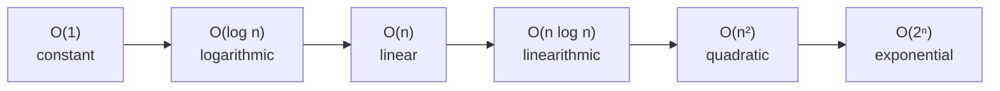
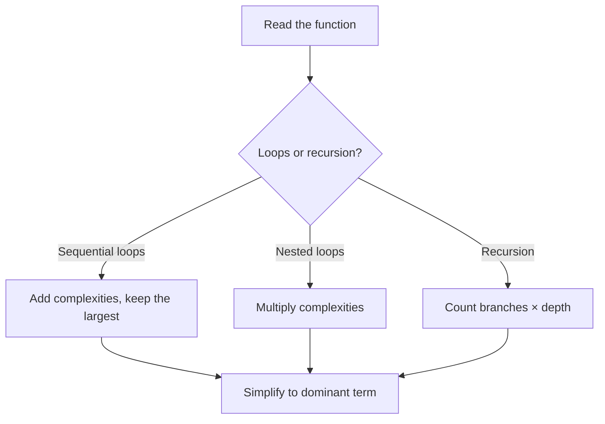

CS Learning Lab / CS Fundamentals / Big-O Notation

# Big-O Notation

`🎯 Fast track` `📚 3 lessons` `⏱ ~40 min` `🏷️ CS Fundamentals` `📅 Generated 2026-09-10`

> **In this course**
> By the end, you'll be able to
> - Explain what Big-O notation measures and why engineers use it
> - Recognize and name the common complexity classes (O(1), O(log n), O(n), O(n log n), O(n²), O(2ⁿ))
> - Read a function and estimate its time and space complexity
> - Use Big-O reasoning to compare two implementations and justify a choice

**Prerequisites:** Comfort reading and writing basic JavaScript/TypeScript (loops, arrays, objects, functions). No algorithms background required.

**Why this matters for you:** As a front-end engineer moving toward full-stack, you'll increasingly write code that runs on servers processing real data volumes: API handlers, data transformations, database query logic. Big-O is the shared vocabulary engineers use to answer "will this scale?" before it becomes a production incident, and it's a near-universal topic in technical interviews.

## Course map

| # | Lesson | Time | You'll learn |
|---|---|---|---|
| 1 | What Big-O measures and why | 12 min | The idea of asymptotic growth, worst-case analysis, and why constants don't matter |
| 2 | The common complexity classes | 15 min | Naming and recognizing O(1) through O(2ⁿ) with real code examples |
| 3 | Analyzing your own code | 13 min | Rules of thumb for loops, nesting, and recursion; a taste of space complexity |

---

## Lesson 1 · What Big-O measures and why

`📖 Lesson 1 of 3` `⏱ 12 min`

> **In this lesson**
> By the end, you'll be able to
> - Define Big-O notation in plain language
> - Explain why Big-O ignores constants and lower-order terms
> - Distinguish worst-case from average-case and best-case analysis

### What is Big-O?

**Big-O notation** describes how the running time (or memory use) of an algorithm grows as the input size, usually called **n**, grows. It doesn't tell you how many milliseconds a function takes on your laptop — it tells you the *shape* of the growth curve as n gets large.

Think of it like describing a car's fuel efficiency as "highway mpg" instead of "gallons used on my specific commute." You're abstracting away the details (traffic, exact route) to get a number that predicts behavior across many situations.

> **Frontend bridge:** You already reason about this informally. You know that `array.find()` has to potentially scan the whole array, while `map.get(key)` jumps straight to the value. That intuition — "this could touch every item" vs. "this is instant regardless of size" — *is* Big-O thinking. This course gives it precise names and lets you apply it to code you didn't write.

### Why we ignore constants

Big-O cares about the **dominant term** as n approaches infinity, and it drops multiplicative constants and smaller terms. An algorithm that does `3n + 100` operations is still **O(n)**, because as n grows huge, the `3` and the `100` become irrelevant compared to the growth driven by n itself.

This matters because it lets you compare algorithms independent of hardware, language, or implementation details. A well-written O(n) function in a slow language will eventually beat a poorly-written O(n²) function in a fast language, once n is large enough.

> **Note:** For small, fixed input sizes, constants can dominate in practice (an O(n²) algorithm can outrun an O(n log n) one for tiny n, due to lower overhead). Big-O is about the trend, not a guarantee for every n.

### Worst case, average case, best case

Most of the time when people say "the Big-O of this algorithm," they mean the **worst case**: the slowest the algorithm can possibly run, for the least favorable input. This is the safe assumption for production systems — you don't want a search feature that's fast for most queries but falls off a cliff for one edge case.

| | Best case | Average case | Worst case |
|---|---|---|---|
| **Purpose** | Fastest possible scenario | Expected performance over typical inputs | Guaranteed upper bound, any input |
| **Best for** | Rarely used alone; sets a floor | Probabilistic/statistical analysis | Capacity planning, SLAs, safety-critical code |
| **Example** | Searching finds the item first try | Hash map lookups, amortized on average | Linear search when the item is last or absent |
| **Trade-offs** | Overly optimistic if quoted alone | Requires assumptions about input distribution | Can be pessimistic for typical real-world inputs |

> **Tip:** When someone gives you a single Big-O value with no qualifier, assume worst case unless they say otherwise.

### Lesson reflection

Before moving on, consider:
- Think of a function you've written (a filter, a search, a sort) — what's its worst-case input?
- Have you ever shipped code that was fast in dev but slow in production because of input size? What made the difference?

### ✅ Quick check

1. Why does Big-O notation typically drop constant factors like the `3` in `3n + 100`?
   - A) Constants are too hard to calculate precisely
   - B) As n grows large, constants become insignificant relative to the growth driven by n
   - C) JavaScript engines optimize constants away automatically
   - D) Constants only matter for space complexity, not time complexity
   - E) Big-O only applies to algorithms without any constant overhead
2. True or false? Mark each statement T or F.
   - I. Big-O measures exact running time in milliseconds.
   - II. Worst-case analysis assumes the least favorable input for the algorithm.
   - III. An O(n) algorithm is always faster in wall-clock time than an O(n²) algorithm, for any n.
   - IV. Big-O describes how running time or memory scales as input size grows.
   - V. Average-case analysis requires assumptions about the distribution of inputs.
3. A teammate says "this function is O(n), so it's always fast enough." What's missing from that statement, and what would you ask them before trusting it?

*Answers are in the Answer key at the end of this file.*

**What's next:** Lesson 2 gives you the vocabulary — the specific complexity classes you'll see over and over in real code.

`← Previous: Course map` · `Next: The common complexity classes →`

---

## Lesson 2 · The common complexity classes

`📖 Lesson 2 of 3` `⏱ 15 min`

> **In this lesson**
> By the end, you'll be able to
> - Name the six complexity classes you'll encounter almost daily
> - Match each class to a recognizable code pattern
> - Order the classes from fastest to slowest growth

### The growth hierarchy

From fastest (best) to slowest (worst), here are the classes you need fluently:



### O(1) — Constant time

The operation takes the same time regardless of input size.

```javascript
function getFirst(arr) {
  return arr[0]; // array index access — always one step
}
```

> **Frontend bridge:** `element.style.color = 'red'`, `map.get(key)`, and `array.push()` are all O(1). You use constant-time operations constantly without naming them.

### O(log n) — Logarithmic time

The problem size is cut in half (or by some fraction) on each step. Binary search is the canonical example: searching a sorted array of 1 million items takes at most ~20 comparisons, not a million.

```javascript
function binarySearch(sortedArr, target) {
  let lo = 0, hi = sortedArr.length - 1;
  while (lo <= hi) {
    const mid = Math.floor((lo + hi) / 2);
    if (sortedArr[mid] === target) return mid;
    if (sortedArr[mid] < target) lo = mid + 1;
    else hi = mid - 1;
  }
  return -1;
}
```

### O(n) — Linear time

Work grows proportionally with input size. Any single pass over a collection is O(n).

```javascript
function sum(arr) {
  let total = 0;
  for (const x of arr) total += x; // one operation per element
  return total;
}
```

### O(n log n) — Linearithmic time

The signature of efficient sorting algorithms (merge sort, quicksort's average case, and what `Array.prototype.sort()` uses under the hood in most engines). It's "do a linear pass, log n times."

```javascript
const sorted = [...arr].sort((a, b) => a - b); // O(n log n) in V8
```

### O(n²) — Quadratic time

Nested iteration over the same collection — a loop inside a loop. Common in naive duplicate-checking or brute-force comparisons.

```javascript
function hasDuplicate(arr) {
  for (let i = 0; i < arr.length; i++) {
    for (let j = i + 1; j < arr.length; j++) {
      if (arr[i] === arr[j]) return true; // comparing every pair
    }
  }
  return false;
}
```

> **Warning:** O(n²) code often looks fine in development with a 10-item test array and becomes a production incident once a customer uploads 50,000 rows. Always ask "what's the realistic max n?"

### O(2ⁿ) — Exponential time

Running time doubles with every additional input element. Common in brute-force recursive solutions that try every subset or combination (naive recursive Fibonacci, generating all subsets of a set).

```javascript
function fib(n) {
  if (n <= 1) return n;
  return fib(n - 1) + fib(n - 2); // branches into 2 calls each time
}
```

### Comparing the extremes

| | O(n) | O(n²) |
|---|---|---|
| **Purpose** | Single pass, proportional work | Compare every pair, nested work |
| **Best for** | Filtering, mapping, summing, simple search | Small, bounded inputs only |
| **Example** | `array.map()`, `array.filter()` | Naive duplicate detection, bubble sort |
| **Trade-offs** | Scales to millions of items fine | Becomes unusable past a few thousand items |

### In practice

1. **Identify the loop structure** — count how many nested loops touch the input, and whether they touch the same collection or different ones.
2. **Check for a halving pattern** — if each step eliminates half the remaining work (like binary search or a balanced tree lookup), you're looking at O(log n).
3. **Watch for hidden loops** — array methods like `.includes()`, `.indexOf()`, and `.find()` are O(n) internally, even though they read as a single call.

### Common pitfalls

- **Assuming array methods are free:** `arr.includes(x)` inside a loop turns an O(n) loop into O(n²) overall, because each `.includes()` call is itself O(n).
- **Confusing "looks like one line" with "is O(1)":** `[...arr].sort()` is one line but O(n log n); string concatenation in a loop can be O(n²) in some languages due to copying.

### Lesson reflection

Before moving on, consider:
- Have you ever called `.includes()` or `.find()` inside a loop over another array? What was the actual complexity?
- Which complexity class do most of your day-to-day React renders or array transformations fall into?

### ✅ Quick check

1. Which complexity class describes binary search on a sorted array?
   - A) O(1)
   - B) O(log n)
   - C) O(n)
   - D) O(n²)
   - E) O(2ⁿ)
2. True or false? Mark each statement T or F.
   - I. `array[index]` access is O(1).
   - II. A single `for` loop over an array is always O(n²).
   - III. Nested loops over the same collection typically indicate O(n²).
   - IV. Naive recursive Fibonacci (calling itself twice per call) is O(2ⁿ).
   - V. `Array.prototype.sort()` in most JS engines is O(n).
3. This function checks whether two arrays share any common element:
   ```javascript
   function shareElement(a, b) {
     for (const x of a) {
       if (b.includes(x)) return true;
     }
     return false;
   }
   ```
   What is its time complexity, and why? What's one way to improve it?

*Answers are in the Answer key at the end of this file.*

**What's next:** Lesson 3 turns this vocabulary into a repeatable process for analyzing any function you're handed.

`← Previous: What Big-O measures and why` · `Next: Analyzing your own code →`

---

## Lesson 3 · Analyzing your own code

`📖 Lesson 3 of 3` `⏱ 13 min`

> **In this lesson**
> By the end, you'll be able to
> - Apply a step-by-step process to estimate a function's time complexity
> - Recognize how recursion translates into a complexity class
> - Explain what space complexity measures and give one example

### A process for reading code

When you're handed an unfamiliar function, work through it in this order:

1. **Find the loops.** Are they sequential (one after another → add their complexities) or nested (one inside another → multiply their complexities)?
2. **Check what each loop iterates over.** A loop over `n` items is O(n); a loop over `n` items that shrinks by half each time is O(log n).
3. **Look inside the loop body.** If it calls another function, check that function's own complexity — a "free-looking" `.includes()` or `.sort()` call inside a loop changes the total.
4. **For recursion, count the branching and the depth.** A function that calls itself once per call, reducing the problem by a constant chunk, is usually O(n). One that calls itself twice per call (like naive Fibonacci) is typically O(2ⁿ).
5. **Combine sequential steps by taking the largest term.** `O(n) + O(n²)` simplifies to `O(n²)`, because the smaller term is dominated as n grows.



### Worked example

```javascript
function processUsers(users) {
  const seen = new Set();          // O(1)
  for (const user of users) {      // loop 1: O(n)
    seen.add(user.id);
  }
  for (const user of users) {      // loop 2: O(n), sequential with loop 1
    if (seen.has(user.managerId)) {
      user.hasManager = true;
    }
  }
  return users;
}
```

Two **sequential** O(n) loops add up to O(n) + O(n) = O(2n), which simplifies to **O(n)** — the constant `2` is dropped. Contrast this with the `hasDuplicate` example from Lesson 2, where the second loop was **nested inside** the first, multiplying to O(n²).

> **Frontend bridge:** This is the exact reasoning behind why `useMemo`/`useCallback` dependency arrays matter, and why a `.map().filter().map()` chain, while readable, does three O(n) passes instead of one — still O(n) overall, but with a higher constant factor worth knowing about when n is large.

### Space complexity, briefly

**Space complexity** measures how much extra memory an algorithm uses relative to input size, using the same O() notation. The `seen` Set above holds up to n items, so it's O(n) **auxiliary space** (extra space beyond the input itself). Binary search, by contrast, uses O(1) space — it only needs a couple of index variables no matter how large the array is.

There's often a **time-space trade-off**: the `hasDuplicate` example from Lesson 2 used O(1) extra space but O(n²) time. You could instead use a Set to get O(n) time at the cost of O(n) space:

```javascript
function hasDuplicateFast(arr) {
  const seen = new Set();
  for (const x of arr) {
    if (seen.has(x)) return true; // O(1) average lookup
    seen.add(x);
  }
  return false; // O(n) time, O(n) space
}
```

> **In the real world:** This trade-off shows up constantly — caching (spend memory to save time), pagination (spend time/requests to save memory), and database indexes (spend disk space to save query time) are all instances of the same idea.

### Common pitfalls

- **Forgetting built-in method costs:** `.slice()`, `.concat()`, and spread (`[...arr]`) all copy the array, an O(n) operation, even though they read as trivial.
- **Treating recursion depth as free:** deep recursion also costs O(depth) space on the call stack, which matters for stack-overflow risk on large inputs, separate from time complexity.

### Lesson reflection

Before moving on, consider:
- Pick a function from a recent project. Walk through the 5-step process above — what's its time and space complexity?
- Where in your own code might you be trading time for space, or vice versa, without having named it that way?

### ✅ Quick check

1. Two loops run one after another (not nested), each O(n). What is the combined complexity?
   - A) O(n)
   - B) O(2n)
   - C) O(n²)
   - D) O(log n)
   - E) It depends on which loop runs first
2. True or false? Mark each statement T or F.
   - I. Nested loops over the same input multiply their complexities.
   - II. Sequential (non-nested) loops add their complexities, then simplify to the dominant term.
   - III. A recursive function that calls itself twice per invocation is always O(n).
   - IV. Space complexity only counts the memory used by the input itself.
   - V. Using a Set to avoid nested loops is a classic time-for-space trade-off.
3. What is the time and space complexity of this function, and why?
   ```javascript
   function reverse(str) {
     let result = '';
     for (let i = str.length - 1; i >= 0; i--) {
       result += str[i];
     }
     return result;
   }
   ```

*Answers are in the Answer key at the end of this file.*

**What's next:** You've completed the Fast track. Request the final exam when you're ready, or come back later to extend this course to the Essential level for amortized analysis, more data-structure comparisons, and tooling.

`← Previous: The common complexity classes` · `Next: Course wrap-up →`

---

## Course wrap-up

### Key takeaways
- Big-O describes how running time or memory scales with input size, not exact speed.
- Worst-case analysis is the default meaning when no qualifier is given.
- The core hierarchy, fastest to slowest: O(1) < O(log n) < O(n) < O(n log n) < O(n²) < O(2ⁿ).
- Sequential steps add complexities and keep the dominant term; nested loops multiply.
- A method call inside a loop (like `.includes()`) can silently turn O(n) into O(n²).
- Recursion's complexity depends on branching factor and depth, not just "it's recursive so it's slow."
- Space complexity uses the same notation to measure extra memory use, and often trades off against time.

### Cheat sheet

| Pattern in code | Likely complexity |
|---|---|
| Direct index/key access (`arr[i]`, `map.get(k)`) | O(1) |
| Halving the search space each step | O(log n) |
| Single loop over n items | O(n) |
| Efficient sort (`.sort()` in most engines) | O(n log n) |
| Nested loop over the same n items | O(n²) |
| Recursion branching into 2+ calls per level | O(2ⁿ) |
| `.includes()`/`.indexOf()`/`.find()` inside a loop | O(n²) overall |
| Extra Set/Map sized to input | O(n) space |

### Course reflection
- Where in your current codebase could an O(n²) pattern be hiding inside what looks like clean, readable code?
- Next time you review a PR, what's one Big-O question you could ask that you wouldn't have asked before this course?

## References

- **[Big O Cheat Sheet](https://www.bigocheatsheet.com/)** · bigocheatsheet.com · Quick visual reference for common data structure and algorithm complexities.
- **[MDN: Array.prototype.sort()](https://developer.mozilla.org/en-US/docs/Web/JavaScript/Reference/Global_Objects/Array/sort)** · MDN Web Docs · Confirms the O(n log n) behavior referenced in Lesson 2, straight from the source you already use daily.

## Related and interesting content

- 🔎 Search: "Big O notation visualized" (multiple well-regarded YouTube explainers exist; verify the channel before watching)
- 📄 *Grokking Algorithms* by Aditya Bhargava, Chapter 1 — a very approachable, visual introduction that pairs well with this course
- 🧰 Search: "Big O complexity interactive visualizer" for browser tools that graph the growth curves side by side
- **Suggested next topics:** Arrays & linked lists (CS Fundamentals), Sorting algorithms (CS Fundamentals), Data structures for full-stack interviews (CS Fundamentals)

---

# Answer key

## Lesson 1
1. **B.** As n grows large, additive/multiplicative constants become insignificant compared to the growth driven by n itself — Big-O captures the trend, not the exact operation count.
2. I-F, II-T, III-F, IV-T, V-T. I: Big-O describes growth *rate*, not milliseconds. III: only true for sufficiently large n — small n can go either way due to constants.
3. **Model answer:** "O(n)" only says the running time grows linearly with input size — it says nothing about the actual size of n in production, or the constant factor. Worth asking: "What's the realistic maximum n in production, and what's the constant overhead per operation?" A function can be O(n) and still be too slow if n is huge or each iteration is expensive (e.g., a network call).

## Lesson 2
1. **B.** Binary search halves the search space on each comparison, giving logarithmic growth.
2. I-T, II-F, III-T, IV-T, V-F. II: a single loop is O(n), not O(n²) — that requires nesting. V: `.sort()` in most JS engines (V8's TimSort variant) is O(n log n), not O(n).
3. **Model answer:** O(n × m) where n and m are the lengths of `a` and `b` (commonly written O(n²) when sizes are similar), because for every element of `a`, `.includes()` scans all of `b`. Improvement: convert `b` to a `Set` first (O(m) to build), then do O(1) average lookups inside the loop over `a`, bringing total time to O(n + m).

## Lesson 3
1. **A.** O(n) + O(n) = O(2n), which simplifies to O(n) since Big-O drops constant multipliers.
2. I-T, II-T, III-F, IV-F, V-T. III: branching recursion is *typically* O(2ⁿ) but depends on whether calls overlap/memoize — not an absolute rule. IV: space complexity counts *extra* (auxiliary) memory used beyond the input, not the input itself.
3. **Model answer:** Time complexity is O(n) — one pass over the string. Space complexity is O(n) as well, because `result` grows to hold a full copy of the string (plus, in some language runtimes, string concatenation in a loop can have hidden copying costs that push practical time toward O(n²) — worth knowing even though the asymptotic loop count is O(n)).

---

## 🏁 Final exam

When you're ready, reply in the same session or chat with `/final-exam`, optionally adding the amount and types, for example `/final-exam 10: 4 MC, 2 TF, 2 open, 2 code-MC`.
